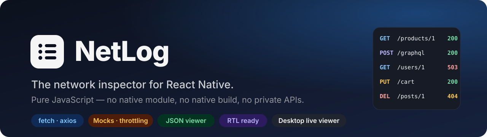
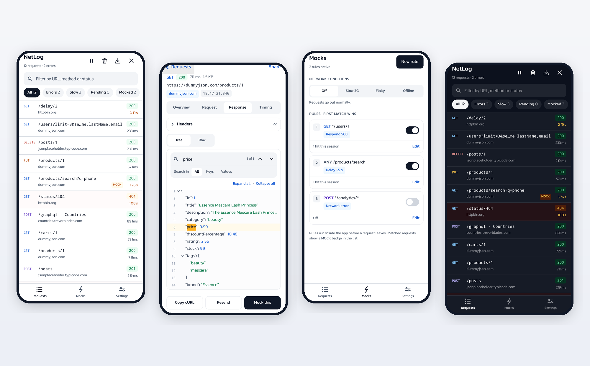
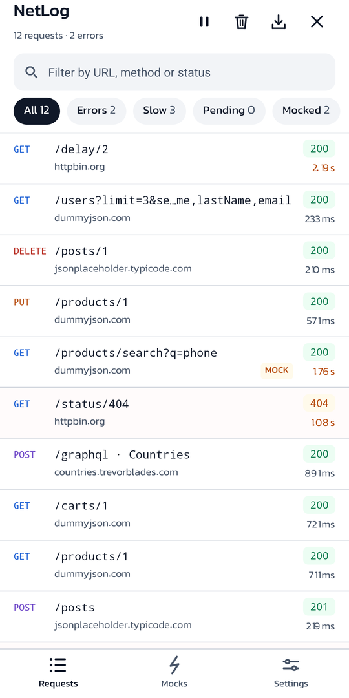
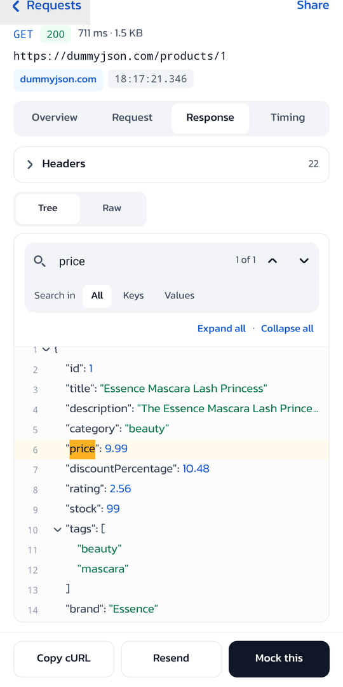
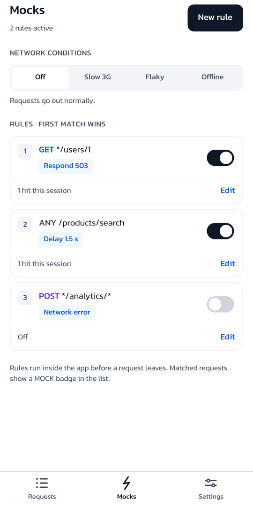
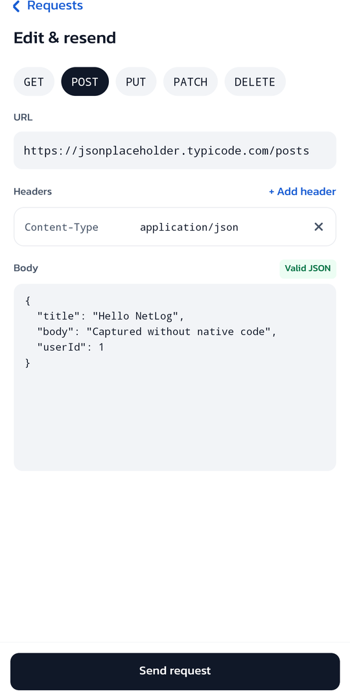
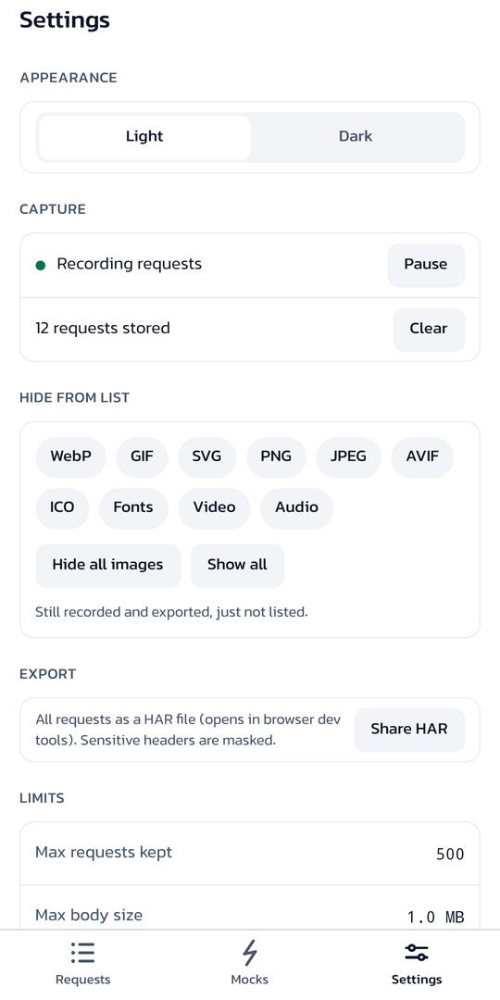
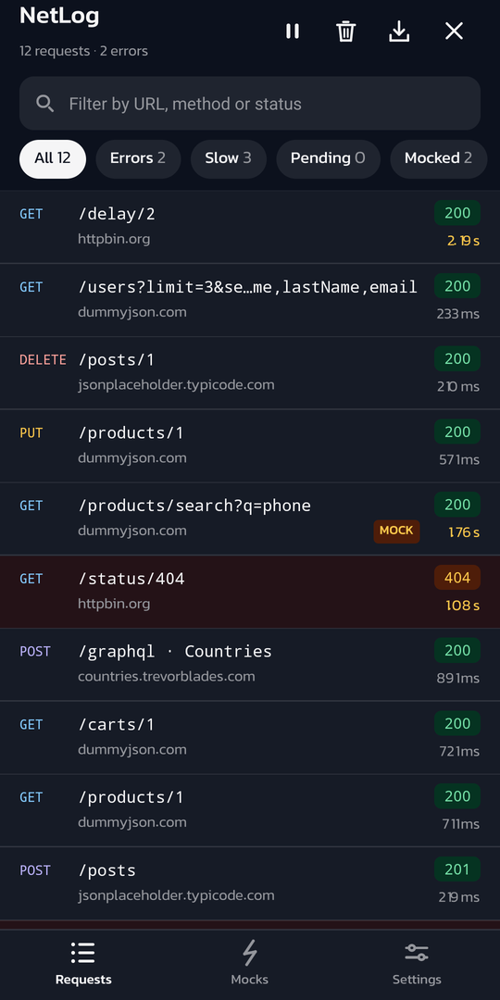
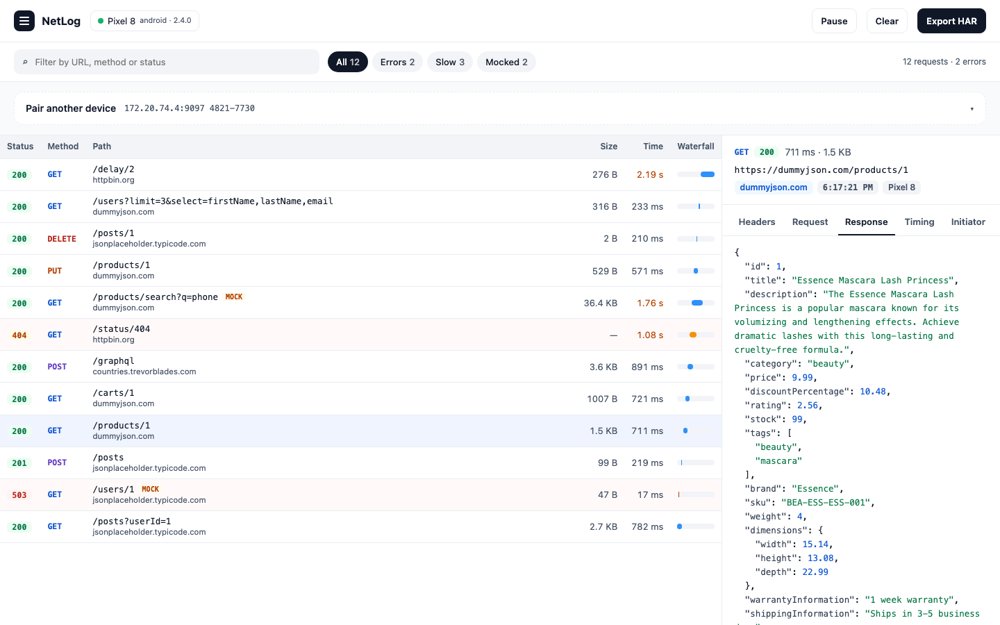

<p align="center">
  
</p>

<p align="center">
  <a href="https://www.npmjs.com/package/react-native-netlog"></a>
  <a href="https://www.npmjs.com/package/react-native-netlog"></a>
  
  
  
  <a href="LICENSE"></a>
  
</p>

<p align="center">
  <b>See every request your React Native app makes, mock the ones you need, and share the rest.</b><br>
  In-app inspector · request mocking · network throttling · searchable JSON viewer · live desktop viewer
</p>

<p align="center">
  
</p>

---

## Why NetLog

- **Zero native code.** Install from npm and reload. No `pod install`, no Gradle changes, no rebuild. It only uses standard JS APIs, so it fits bare React Native and Expo apps alike (tested on React Native 0.83, new architecture, Hermes).
- **No private React Native APIs.** NetLog wraps the standard `XMLHttpRequest`, so it keeps working across React Native upgrades. `fetch`, axios and most other HTTP clients go through it.
- **Mock without a backend.** Answer any request with a status and body, add latency, or fail it like a dead network. Switch the whole app to Slow 3G, Flaky or Offline from a menu.
- **Built for real apps.** It uses a virtualized list with throttled updates, and a JSON viewer that stays fast on multi-megabyte responses. It also works in RTL apps, supports dark mode, and works across several JS bundles (Module Federation) through one shared store.
- **Shareable.** Copy as cURL, share a request, export a HAR file, or stream everything to your desktop browser.

## Quick start

```bash
npm install react-native-netlog react-native-netlog-ui
# or
yarn add react-native-netlog react-native-netlog-ui
```

**1. Start capturing as early as possible** (e.g. in `index.js`):

```ts
import { initNetLog } from 'react-native-netlog';

if (__DEV__) {
  initNetLog();
}
```

**2. Show the inspector** anywhere, e.g. as a screen in your navigator:

```tsx
import { NetLogScreen } from 'react-native-netlog-ui';

export function NetworkScreen({ navigation }) {
  return <NetLogScreen onClose={() => navigation.goBack()} />;
}
```

**3. (Optional) Add the floating bubble** so the inspector is one tap away:

```tsx
import { NetLogBubble } from 'react-native-netlog-ui';

<NetLogBubble onPress={() => navigation.navigate('Network')} />
```

That's it. Reload the app and make a request.

## Screenshots

<table>
  <tr>
    <td align="center"><br><sub><b>Requests</b><br>search, filters, MOCK badges</sub></td>
    <td align="center"><br><sub><b>Response</b><br>searchable JSON tree</sub></td>
    <td align="center"><br><sub><b>Mocks</b><br>rules and network conditions</sub></td>
  </tr>
  <tr>
    <td align="center"><br><sub><b>Edit &amp; resend</b><br>change anything, send again</sub></td>
    <td align="center"><br><sub><b>Settings</b><br>hide images, fonts and media</sub></td>
    <td align="center"><br><sub><b>Dark mode</b><br>light and dark themes</sub></td>
  </tr>
</table>

## Features

### 🔍 Inspect
- Live request list with search, **All / Errors / Slow / Pending / Mocked** filters and GraphQL operation names
- Request details: status, timing, size, host, the **JS stack that sent the request**, headers, bodies
- **JSON viewer**: collapsible tree, syntax colors, line numbers, search keys and/or values with next/previous, copy a path (`$.data.items[0].price`) or value. Tree / Raw toggle
- Timing breakdown (waiting for server vs. download)
- Hide noise: images (WebP, GIF, SVG, PNG, JPEG, AVIF, ICO), fonts, video and audio, from Settings

### 🧪 Mock &amp; throttle
- **Rules**: match by method and URL pattern (`*/v1/cart/*`), then
  - **respond** with any status, headers and body (optionally after a delay)
  - **delay** the real request
  - **fail** like a broken connection or a timeout
- **Mock this**: turn any captured response into a rule in one tap, then edit it
- **Network conditions**: Off · Slow 3G · Flaky (10% failures) · Offline
- Rules work for `fetch`, axios and anything else built on XHR. Mocked requests never leave the device

### 📤 Share
- **Copy as cURL** · **Share** a request as text · **Export HAR** (opens in browser dev tools, Charles, Proxyman…)
- **Edit &amp; resend** with a different method, URL, headers or body
- Authorization and cookie headers are masked in shared output

### 🖥️ Desktop live viewer

Run `npx netlog-desktop`, scan the QR code from the app, and watch traffic live in your browser.

<p align="center"></p>

→ [Desktop viewer guide](packages/desktop/README.md)

## Packages

| Package | | |
|---|---|---|
| [`react-native-netlog`](packages/core) | [](https://www.npmjs.com/package/react-native-netlog) | Capture, store, mocks, network conditions, cURL/HAR export, desktop pairing client |
| [`react-native-netlog-ui`](packages/ui) | [](https://www.npmjs.com/package/react-native-netlog-ui) | The in-app inspector (`NetLogScreen`, `NetLogBubble`, building blocks) |
| [`react-native-netlog-json-viewer`](packages/json-viewer) | [](https://www.npmjs.com/package/react-native-netlog-json-viewer) | Standalone, fast, searchable JSON tree viewer for React Native |
| [`react-native-netlog-desktop`](packages/desktop) | [](https://www.npmjs.com/package/react-native-netlog-desktop) | `npx netlog-desktop`: pairing QR code and live browser viewer |

npm package names are lowercase, so the packages are `react-native-netlog*`; the project is NetLog.

## Configuration

```ts
initNetLog({
  maxEntries: 500,                    // oldest requests are dropped
  maxBodyLength: 1024 * 1024,         // bodies are cut to this many characters
  ignore: [/\/symbolicate$/, (method, url) => url.includes('analytics')],
  captureStack: true,                 // record which code sent each request
  redactHeaders: ['authorization', 'cookie', 'set-cookie'],
  features: { qrPairing: true },      // desktop pairing; set false to keep traffic on the device
  capture: true,                      // false = configure only
});
```

`<NetLogScreen>` props:

| Prop | Default | |
|---|---|---|
| `theme` | `'light'` | `'light'`, `'dark'`, or partial theme tokens |
| `onThemeChange(mode)` | | Called when the user switches light/dark in Settings |
| `onClose` | | Shows a close button |
| `onCopy(text)` | share sheet | Your clipboard, e.g. `Clipboard.setString` |
| `hiddenTypes` | `[]` | Resource types hidden at first, e.g. `['webp', 'gif', 'svg']` |
| `initialEntryId` | | Open this request first |
| `labels` | English | Override any text (localization) |
| `renderScanner` | | QR scanner for desktop pairing (bring your camera library) |
| `device` | | Name and version shown on the desktop |

## Recipes

<details>
<summary><b>Only in development and QA builds</b></summary>

```ts
if (__DEV__ || Config.FLAVOR === 'qa') {
  initNetLog();
}
```

Render `NetLogScreen` only behind the same check, so release builds don't include its UI code path.
</details>

<details>
<summary><b>Clipboard</b></summary>

NetLog has no native dependencies, so it uses the share sheet unless you pass your clipboard:

```tsx
import Clipboard from '@react-native-clipboard/clipboard';

<NetLogScreen onCopy={(text) => Clipboard.setString(text)} />
```
</details>

<details>
<summary><b>Keep mock rules across restarts</b></summary>

```ts
import AsyncStorage from '@react-native-async-storage/async-storage';
import { setMockStorage } from 'react-native-netlog';

setMockStorage(AsyncStorage);
```
</details>

<details>
<summary><b>Mock from code (tests, demos)</b></summary>

```ts
import { addMockRule, setNetworkCondition } from 'react-native-netlog';

addMockRule({ method: 'POST', url: '*/v1/cart/*', action: { type: 'respond', status: 500, body: '{"error":"x"}' } });
addMockRule({ method: '*', url: '/search', action: { type: 'delay', ms: 3000 } });
setNetworkCondition('offline');
```
</details>

<details>
<summary><b>Never send traffic off the device</b></summary>

```ts
initNetLog({ features: { qrPairing: false } });
```

The desktop pairing UI is hidden and pairing calls are refused. Everything else keeps working.
</details>

<details>
<summary><b>Use the JSON viewer on its own</b></summary>

```tsx
import { JsonViewer } from 'react-native-netlog-json-viewer';

<JsonViewer json={text} theme="dark" initialExpandDepth={2} />
```
</details>

## API

**`react-native-netlog`**

| | |
|---|---|
| `initNetLog(config)` | Configure and start capture |
| `configure(config)` · `startCapture()` · `stopCapture()` | Lower-level setup |
| `getEntries()` · `subscribe(listener)` · `clearEntries()` | Read and watch captured requests |
| `setPaused(boolean)` · `isPaused()` | Pause capture (mocks keep working) |
| `addMockRule` · `updateMockRule` · `removeMockRule` · `getMockRules` · `mockRuleFromEntry` | Mock rules |
| `setNetworkCondition('off' \| 'slow' \| 'flaky' \| 'offline')` | Network conditions |
| `setMockStorage(storage)` | Persist rules (e.g. AsyncStorage) |
| `toCurl(entry)` · `toHar(entries)` · `toShareText(entry)` · `resend(entry, overrides)` | Export and replay |
| `pairFromPayload(text)` · `handleNetLogUrl(url)` · `connectToDesktop(info)` · `disconnectFromDesktop()` | Desktop pairing |

**`react-native-netlog-ui`**: `NetLogScreen`, `NetLogBubble`, and the building blocks `RequestList`, `RequestDetail`, `MocksPanel`, `DesktopPairing`, `useEntries()`, `usePaused()`, `useNetLogFeature()`.

**`react-native-netlog-json-viewer`**: `JsonViewer`, plus a React-free core (`react-native-netlog-json-viewer/core`) with `buildTree`, `searchTree`, `visibleRows`, `getPath`.

## How it works

NetLog wraps `XMLHttpRequest.prototype` (`open`, `setRequestHeader`, `send`), which React Native's `fetch` and axios both use. Each request becomes an entry in one store on `globalThis`, so several copies of the package in different bundles share it. The UI subscribes with throttled updates (at most every 250 ms), so a burst of requests doesn't cause a burst of renders. Mock rules run inside `send()`: a mocked response is delivered through the normal XHR properties and events, so the caller can't tell the difference.

## Limitations

- **JS requests only.** Requests made by native code don't go through JS: `<Image>` loading, WebViews, native SDKs. Use a proxy (Charles, Proxyman) for those.
- **Timing** is measured in JS from `send()` to `load`. DNS, TLS and connection time aren't visible.
- **WebSocket** frames aren't captured yet.

## Contributing

```bash
git clone https://github.com/Kaveh-ap/react-native-netLog.git
cd react-native-netLog
npm install
npm test          # unit and end-to-end tests
npm run typecheck
npm run build
```

Issues and pull requests are welcome. Please include a test for bug fixes.

## License

[MIT](LICENSE)
