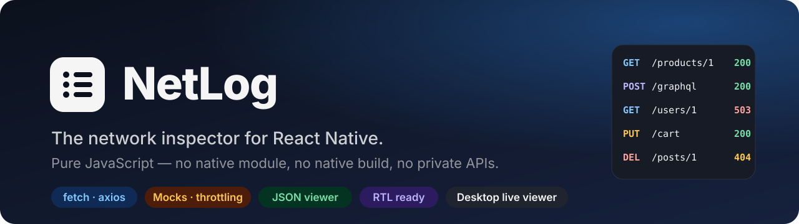
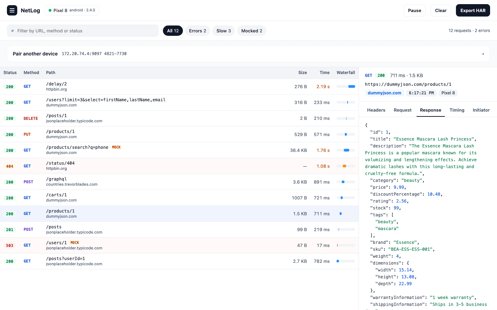
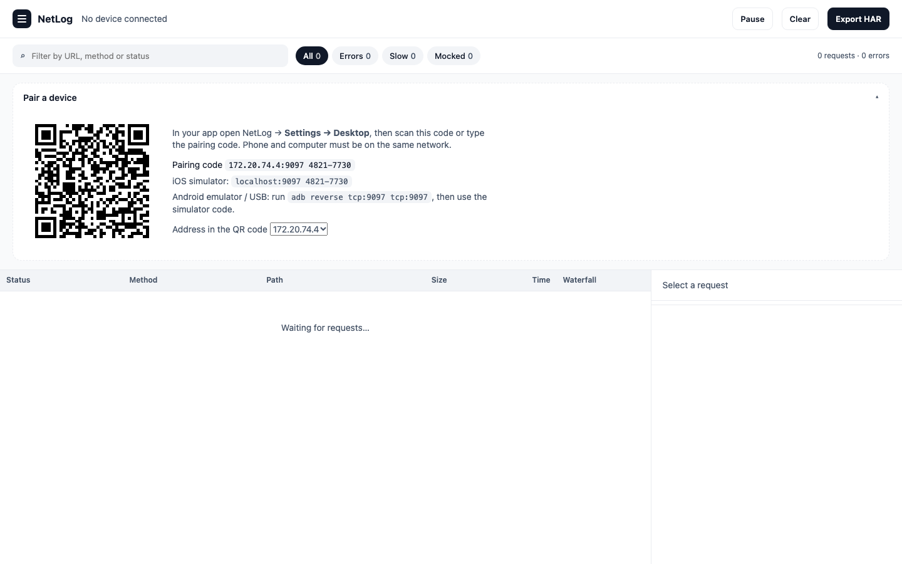
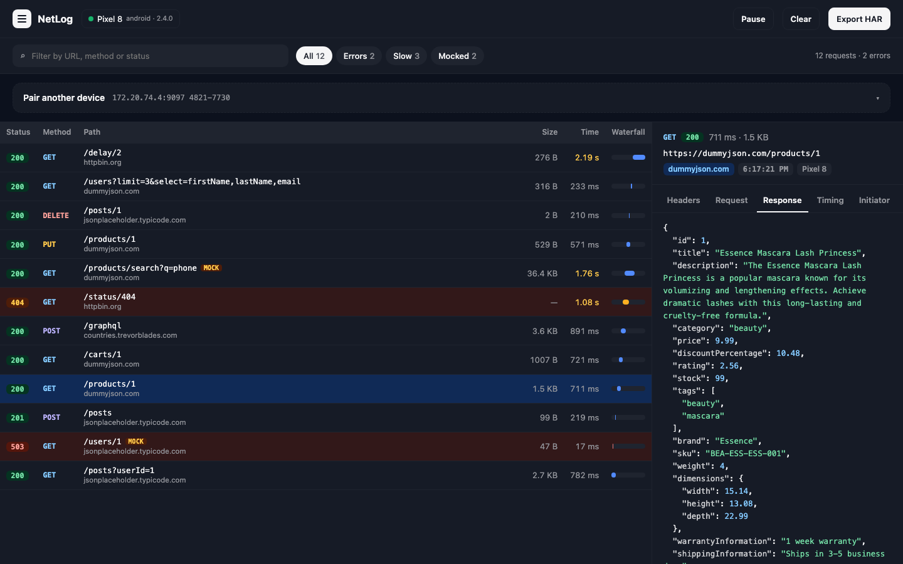

<p align="center">
  
</p>

# NetLog Desktop

**Watch your React Native app's network traffic live in your browser.** Pair a phone, simulator or emulator by scanning a QR code; every request the app makes shows up on your computer as it happens, with headers, bodies, timing and the code that sent it.

<p align="center">
  
</p>

- Zero install: `npx netlog-desktop`
- Pair by QR code or a short pairing code
- Several devices at once
- Filter by text, errors, slow requests, mocked requests
- Waterfall timeline, highlighted JSON, headers, timing and stack trace per request
- Pause and clear capture on the device from your computer
- Export everything as HAR
- Light and dark, follows your system

## Contents

1. [Requirements](#requirements)
2. [Start the viewer](#1-start-the-viewer)
3. [Add pairing to your app](#2-add-pairing-to-your-app)
4. [Pair a device](#3-pair-a-device)
5. [Using the viewer](#using-the-viewer)
6. [CLI options](#cli-options)
7. [Security](#security)
8. [Troubleshooting](#troubleshooting)
9. [Programmatic API](#programmatic-api)
10. [Releases](#releases)

## Requirements

- Node.js 20 or newer on your computer
- Your app uses [`react-native-netlog`](https://www.npmjs.com/package/react-native-netlog) (capture) and [`react-native-netlog-ui`](https://www.npmjs.com/package/react-native-netlog-ui) (pairing screen)
- The device and computer can reach each other: same Wi-Fi, a simulator on the same Mac, or an Android device/emulator over `adb`

## 1. Start the viewer

```bash
npx netlog-desktop
```

```
NetLog desktop is running

  Viewer:        http://localhost:9099
  Pairing code:  192.168.1.5:9099 4821-7730
  Simulator/USB: localhost:9099 4821-7730   (Android USB: adb reverse tcp:9099 tcp:9099)

Scan with the app (NetLog → Connect to desktop):
█▀▀▀▀▀█ ▄▀▄▀▄ █▀▀▀▀▀█
...
```

Open **http://localhost:9099**. Until a device connects, the page shows the pairing QR code:

<p align="center">
  
</p>

You can also install it once and run it without `npx`:

```bash
npm install -g react-native-netlog-desktop
netlog-desktop
```

## 2. Add pairing to your app

Pairing is on by default. `NetLogScreen` shows it under **Settings → Desktop**:

```tsx
import { initNetLog } from 'react-native-netlog';
import { NetLogScreen } from 'react-native-netlog-ui';

initNetLog(); // features.qrPairing defaults to true

<NetLogScreen device={{ name: 'Pixel 8', appVersion: '2.4.0' }} />;
```

Without a camera, users type the pairing code. To scan the QR code, pass your app's scanner. With [react-native-vision-camera](https://react-native-vision-camera.com):

```tsx
import { StyleSheet } from 'react-native';
import { Camera, useCameraDevice, useCodeScanner } from 'react-native-vision-camera';

function QrScanner({ onScan }: { onScan: (text: string) => void }) {
  const device = useCameraDevice('back');
  const codeScanner = useCodeScanner({
    codeTypes: ['qr'],
    onCodeScanned: (codes) => {
      const value = codes[0]?.value;
      if (value) onScan(value);
    },
  });
  if (!device) return null;
  return <Camera style={StyleSheet.absoluteFill} device={device} isActive codeScanner={codeScanner} />;
}

<NetLogScreen renderScanner={({ onScan }) => <QrScanner onScan={onScan} />} />;
```

The app needs camera permission for scanning; typing the code needs none.

**Deep links (optional).** The QR code contains `netlog://pair?u=…&t=…`. If your app registers the `netlog` URL scheme, the phone's camera app can open it directly:

```ts
import { Linking } from 'react-native';
import { handleNetLogUrl } from 'react-native-netlog';

Linking.addEventListener('url', ({ url }) => handleNetLogUrl(url));
```

**Turning it off.** Apps that must never send traffic off the device:

```ts
initNetLog({ features: { qrPairing: false } });
```

The Desktop section disappears and pairing calls are refused.

## 3. Pair a device

| Where the app runs | What to do |
|---|---|
| **Phone on the same Wi-Fi** | Scan the QR code, or type the pairing code (`192.168.1.5:9099 4821-7730`) |
| **iOS simulator** | Type the simulator code: `localhost:9099 4821-7730` |
| **Android emulator** | Run `adb reverse tcp:9099 tcp:9099`, then type `localhost:9099 4821-7730` |
| **Android phone over USB** | Same as the emulator: `adb reverse`, then the `localhost` code. Works even when Wi-Fi blocks devices from talking to each other |

Once paired, the device appears in the viewer's header, the pairing panel collapses to a one-line **Pair another device** bar, and the app's status reads **Connected to …**. If the connection drops (Wi-Fi change, computer sleeps), the app reconnects on its own and re-sends what it captured meanwhile.

## Using the viewer

| | |
|---|---|
| **Filter** | Type to filter by URL, method or status. Chips: All, Errors, Slow (> 1 s), Mocked |
| **Waterfall** | Each bar shows when a request started and how long it took, relative to the others |
| **Details** | Click a request: status, time, size, host, device. Tabs for headers, request body, response body (highlighted JSON), timing and initiator (the JS stack that sent it) |
| **Link to a request** | The URL updates when you select a request (`#device:id`). Reload or share the link to come back to it |
| **Pause / Clear** | Pauses or clears capture **on the device** |
| **Export HAR** | Downloads everything as a `.har` file for Chrome DevTools, Charles, Proxyman, etc. |
| **Several devices** | Pair as many as you like; a Device column appears when more than one is connected |

<p align="center">
  
</p>

## CLI options

```
netlog-desktop [--port 9099] [--token 1234-5678] [--name "My Mac"] [--allow-remote-viewer]
```

| Option | Default | |
|---|---|---|
| `--port` | `9099` | Port for devices and the viewer |
| `--token` | random | Pairing code. Set it to keep the same code across restarts |
| `--name` | computer name | Shown in the app when connected |
| `--allow-remote-viewer` | off | Let other computers open the viewer (see Security) |
| `--help` | | Show usage |

## Security

- **Pairing is token-protected.** A device must present the pairing code; a wrong code is rejected and the app stops retrying.
- **The viewer is local by default.** Only this computer can open the viewer, because it shows captured traffic and can pause or clear devices. Devices still connect from your network. Use `--allow-remote-viewer` only on networks you trust.
- **Secrets are masked before they leave the device.** `Authorization`, `Cookie` and `Set-Cookie` headers arrive as `[redacted]` (configure with `redactHeaders` in `initNetLog`).
- **Nothing leaves your network.** The app talks directly to your computer; there is no cloud service.

## Troubleshooting

<details>
<summary><b>The app can't connect (stays on "Connecting…")</b></summary>

- Phone and computer must be on the same network. Guest and office Wi-Fi often block devices from reaching each other: use USB with `adb reverse`, or a hotspot.
- Allow incoming connections for Node.js if your firewall asks (macOS shows a prompt the first time).
- Check the address in the QR code. If your computer has several network interfaces (VPN, Docker), pick the right one in **Address in the QR code**.
</details>

<details>
<summary><b>Android: works on the emulator but not on a release-like build</b></summary>

Android blocks unencrypted (`ws://`) connections unless the app allows cleartext traffic. Debug builds usually allow it; QA or release-like builds may not. Allow it only in that build flavor's network security config (never in production):

```xml
<!-- android/app/src/qa/res/xml/network_security_config.xml -->
<network-security-config>
  <base-config cleartextTrafficPermitted="true" />
</network-security-config>
```

```xml
<!-- android/app/src/qa/AndroidManifest.xml -->
<application android:networkSecurityConfig="@xml/network_security_config" />
```

`domain-config` matches host names, not IP ranges, which is why a LAN address needs the flavor-wide setting.
</details>

<details>
<summary><b>"Wrong pairing code"</b></summary>

The code changes every time `netlog-desktop` starts. Use `--token` to keep a fixed one, and scan or type the current code again.
</details>

<details>
<summary><b>Requests show up in the app but not on the desktop</b></summary>

Make sure the app status says **Connected**. If capture was paused from the desktop, press **Resume**. Requests made while paused are not recorded anywhere.
</details>

<details>
<summary><b>Images, WebViews or native SDK requests are missing</b></summary>

NetLog captures requests made from JavaScript (`fetch`, axios, XHR). Requests made by native code never reach JS; use a proxy such as Charles or Proxyman for those.
</details>

## Programmatic API

```js
import { startServer } from 'react-native-netlog-desktop';

const server = await startServer({ port: 9099, token: '1234-5678', name: 'CI runner' });
server.pairing();          // { link, localLink, code, hosts, port, token }
server.entries();          // captured requests from all devices
server.devices();          // connected devices
server.sendCommand(undefined, 'clear'); // 'pause' | 'resume' | 'clear', to one device id or all
server.on((event) => {});  // 'devices' | 'snapshot' | 'entries' events
await server.close();
```

Useful in end-to-end tests: start a server, pair the app under test, and assert on the traffic it sent.

## Releases

See the [changelog](https://github.com/Kaveh-ap/react-native-netLog/blob/main/CHANGELOG.md) and [GitHub releases](https://github.com/Kaveh-ap/react-native-netLog/releases).

## License

MIT
